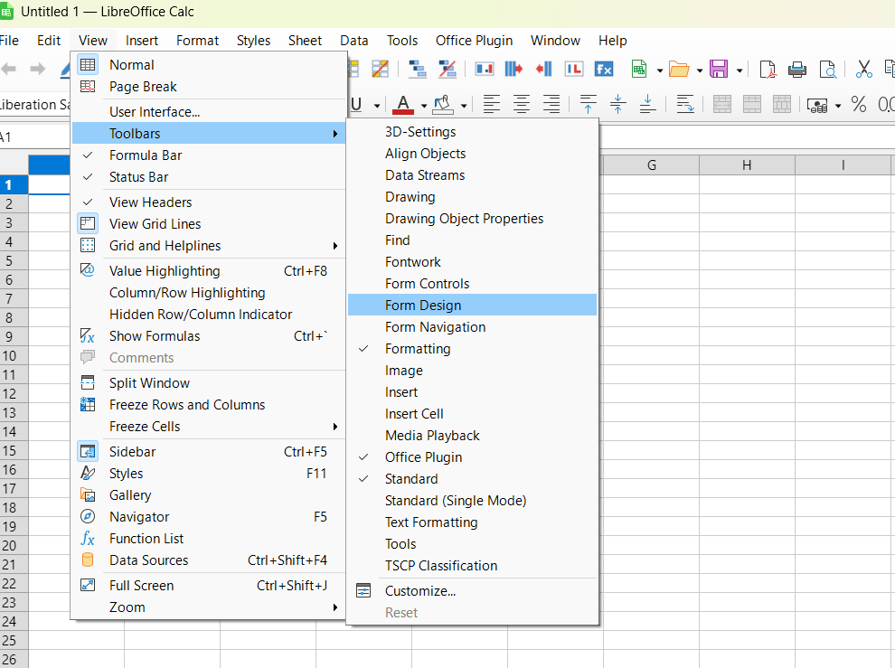

# Office Plugin for LibreOffice and OpenOffice

An installable Python-UNO extension that adds practical spreadsheet and document tools to LibreOffice and compatible OpenOffice environments.



## Features

- Calc tools for filling blanks, removing duplicates, highlighting values, finding missing sequence numbers, and transposing tables.
- Number helpers for decimal precision, number words, units, and custom functions.
- Data utilities for set operations, visible-cell selection, and removing blank rows or columns.
- Gantt-chart generation from task tables.
- Navigation history and last-edit shortcuts for moving around large documents.
- Undo-aware editing paths designed to work with LibreOffice's standard undo stack.

## Requirements

- LibreOffice 4.1 or later. Current development and end-to-end checks use a modern LibreOffice installation on Windows.
- Python 3.8 or later to build and run the pure-Python tests.
- LibreOffice's bundled Python runtime for the optional end-to-end smoke test.

No third-party Python packages are required for the build or unit tests.

## Install

1. Build the extension package:

   ```powershell
   python build_oxt.py
   ```

2. Close LibreOffice.
3. Install `dist/office_plugin_lo.oxt` by double-clicking it, or run:

   ```powershell
   & 'C:\Program Files\LibreOffice\program\unopkg.exe' add --suppress-license dist\office_plugin_lo.oxt
   ```

4. Restart LibreOffice and open the **Office Plugin** toolbar or menu.

## Usage

In Calc, select the cells or table you want to work with, then choose a command from the Office Plugin toolbar or menu. Commands open focused dialogs when options or ranges are needed. The Gantt tool expects a task table with identifiers, durations, dates, and optional dependencies.

The repository includes a sample workbook at `samples/office_plugin_test_data.xlsx`. More trial workbooks are available in [Google Drive](https://drive.google.com/drive/folders/14HF6INSWjoa4Lqm4YUmfUdUVwo_P6vZf?usp=drive_link).

## Development

Build the extension:

```powershell
python build_oxt.py
```

Run the pure-Python test suite:

```powershell
python -m unittest discover -s tests -t .
```

Run the optional end-to-end smoke test with LibreOffice installed:

```powershell
& 'C:\Program Files\LibreOffice\program\python.exe' tests\headless_smoke.py
```

## Known limitations

- Mouse and keyboard interaction paths require manual checking because they cannot be fully reproduced in a headless test.
- Undo restores normal cell edits, but LibreOffice does not record undo for some conditional-format changes; re-run the relevant command to restore those formats.
- Some hyperlink-navigation behaviours depend on the LibreOffice build and document type.
- Custom spreadsheet functions require the extension to be installed on every machine that opens a workbook using them.

## Privacy and security

The extension works locally in LibreOffice. Keep documents and extension packages in trusted locations, and review any workbook macros according to your organization’s security policy.

## Support

Support the project through the [donation page](https://drive.google.com/file/d/14KBkEcr6j4KaxDHcHyejdYlFDt4GjR6O/view?usp=drive_link).

## License

This project is released under the [MIT License](LICENSE).
